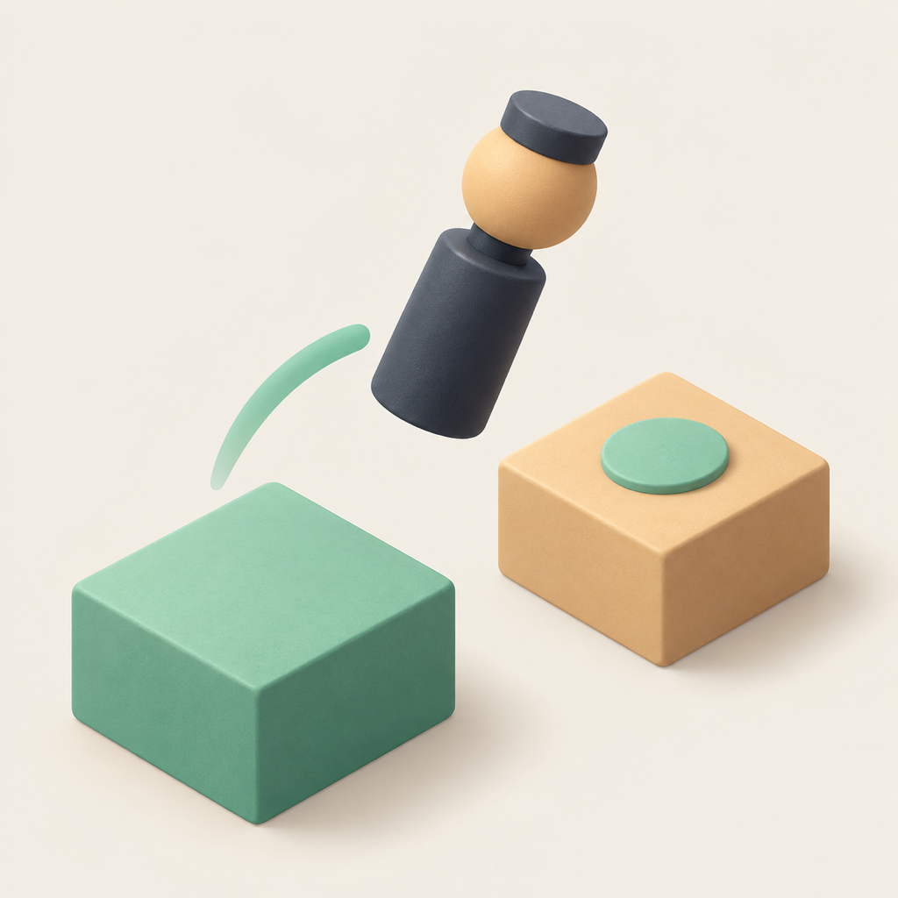

# JumpJump 跳一跳

  

**按住蓄力，松手起跳。找到节奏，再跳远一点。**

JumpJump 是一款适合随时玩上一局的 iPhone 休闲跳跃游戏。控制小棋子在错落的平台之间前进，根据距离掌握蓄力时机，瞄准中心、积累连击，挑战自己的最高纪录。

## 游戏特色

- **单手轻松玩**：按住与松开，两个动作就能完成一次跳跃。
- **简洁立体画面**：柔和配色搭配几何平台，让每一步落点都清晰直观。
- **中心连击奖励**：连续落在平台中心，收获逐次递增的加分。
- **生动的跳跃反馈**：翻转起跳、落地光环、加分飘字，配合音效与触觉反馈。
- **辅助练习模式**：用可视化力度提示练习蓄力，逐渐找到自己的手感。
- **个人纪录挑战**：自动保存本机最高分，随时重开，再试一次。
- **声音自由切换**：通过底部开关选择是否播放游戏音效。

## 怎么玩

1. 在游戏区域的空白处按住屏幕，为小棋子蓄力。
2. 观察下一块平台的距离：平台越远，通常需要蓄力越久。
3. 松开手指，小棋子立即起跳。
4. 落在下一块平台上继续前进；尽量瞄准中心，争取连击。

短跳落回当前平台时，可以继续尝试。掉落后，点击「再来一局」重新挑战；也可以随时点击底部「重开」开始新的一局。

## 得分规则

飘出的数字就是当前这一跳获得的分数。

| 落点 | 本次得分 |
| --- | --- |
| 成功落在下一块平台的非中心区域 | +1 |
| 命中下一块平台的中心区域 | +2 |
| 连续第二次命中中心 | +4 |
| 连续第三次命中中心 | +6 |
| 继续保持中心连击 | 每次递增 2 分 |

一次普通落点会结束中心连击，下次命中中心重新从 +2 开始。落回当前平台不加分，也不会打断已有连击。

例如：**中心 → 中心 → 普通落点 → 中心**，依次获得 **+2、+4、+1、+2**。

## 辅助练习模式

想更直观地掌握蓄力时机，可以连续点击顶部得分 **10 次**开启辅助模式，再次连点 **10 次**关闭。点击时保持连贯，相邻两次间隔不要超过 3 秒。

开启后，屏幕底部会显示力度参考：

- **蓝色进度与圆点**：当前蓄力进度。
- **绿色区间**：建议松手的力度范围。
- **深色竖线**：瞄准下一块平台中心的理想力度。
- **数值提示**：目标力度、建议按压时长与当前力度。

提示会随当前站位和下一块平台更新，帮助你练习从判断距离到松手起跳的节奏。

辅助模式默认关闭。重开一局会保留当前选择，重新启动游戏后恢复关闭。

## 支持设备

适用于运行 **iOS 18 及以上版本**的 iPhone。
